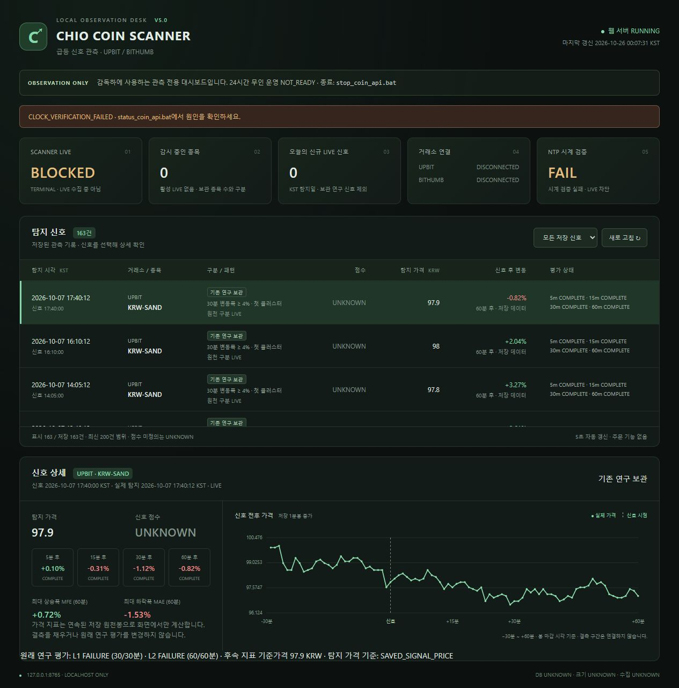

# CHIO COIN SCANNER V5.0 — 독립 웹 대시보드 검증

기준 커밋 `c832f920f4aac010a88bab25ca8a3315c3d4b91c`. 작업/측정: 2026-10-25 23시대~10-26 00시대 KST.

**대시보드·BAT 기능 PASS / 관측 인프라 PARTIAL / 24시간 무인 운영 NOT_READY.**
실제 최종 LIVE admission은 NTP 표본 부족으로 BLOCKED다. 안전 기준을 완화하지 않았다.
관측 정확도·수익성을 검증하거나 승인한 결과가 아니다.

## 구현 범위

- Python 표준 라이브러리 `ThreadingHTTPServer`, 로컬 HTML/CSS/JS/SVG만 사용. 프레임워크·패키지 설치 없음.
- 단일 다크 페이지에 별도 웹/Scanner 상태, 실제 감시 범위, KST 오늘의 LIVE 신호, 장부 기반 거래소 연결, 신선도를 포함한 기존 NTP 검증 상태를 표시한다.
- 원본 연구 163개와 신규/이전 관측 저장소를 구별한다. 목록·상세·자동 갱신·동일 탭 새로고침 복구·빈 상태·명확한 읽기 오류를 구현했다.
- 후속 지표는 저장된 평가를 우선 사용한다. 기존 보관 DB의 표시용 지표만 연속된 실제 저장 봉으로 계산한다. 누락 봉을 만들지 않고 원래 L1/L2 평가도 별도 표시한다. 탐지 엔진에는 값을 전달하지 않는다.
- BAT 이름과 Python 탐색·기존 관측 엔진·전체 NTP/Windows gate·중복 잠금·단조 제한·STOP·HTTP/자원 상한은 재사용한다. 시작 BAT는 별도 웹을 띄우고 기존 관리자를 백그라운드로 실행한다. clock 실패 시에도 웹은 조회 가능하다.
- 로컬 바인딩, Windows 독점 포트, Host/Origin 검사, CSP, 정적 파일 허용 목록, 읽기 전용 SQLite, 제한된 동시 요청/로그를 적용했다. 임의 DB 경로·환경변수·API 키·프로세스 식별 정보는 웹에 노출하지 않는다. 쓰기/주문/전략 변경 API 없음.

## 실제 발견·수정한 결점

첫 실제 시작에서 대시보드/시작기의 상태 JSON 읽기와 관리자의 원자적 교체가 충돌해 Windows `WinError 5`가 발생했다.
기존 정상 종료 경로가 STOP을 전달했고 worker는 정상 reap됐다. 원본 DB에는 접근하거나 쓰지 않았다.

관리 JSON에 한해 10ms 간격·최대 0.5초의 원자적 교체 재시도를 추가했다. 읽기는 크기를 제한하고 파일을 닫은 뒤 파싱한다.
일시적 Windows 공유 충돌만 재시도하며 지속적인 접근 오류는 그대로 실패한다. 실제 열린 파일 핸들을 유지한 충돌 주입과 지속 오류 제한 테스트를 통과했다.
원천/관측 DB 쓰기나 시계 검증 코드는 변경하지 않았다. 정상 수집 간격이나 탐지 규칙 변경도 없다.

Python bootstrap의 기존 `venv` 경로 두 곳에 섞인 수직 탭 문자를 실제 `\venv`로 수정했다.
잘못된 Python/명시 venv의 차단 정책은 유지했다.

## 제한된 실제 실행

사전에 [preflight](../reports/scanner_v50_20261025/preflight.json)에 두 번, 각 120초/80 HTTP, 총 최대 240초/160 HTTP,
NTP 최대 72패킷, 기존 두 거래소·고정 5종목을 고정했다. 추가 실제 시작은 하지 않았다.

|시도|실제 시각 KST|결과|
|---|---|---|
|1 관리 시작|10-25 23:58:53.202~23:59:08.462|관리·supervisor·worker 전체 시계 검증 PASS 후 관리 상태 파일 충돌로 BLOCKED|
|1 worker|23:59:03.348~23:59:08.070, 단조 4.721초|STOP_REQUESTED, 거래소 HTTP 0, 신규 신호 0, close_errors 없음, returncode 0, reaped=true, forced_kill=false|
|2 관리 시작|10-26 00:00:47.889 부근~00:00:56.513 부근|Windows 루트 거리 0.14231135초로 PASS. 직접 NTP 필수 6표본 중 5개만 유효해 CLOCK_REFERENCE_MEASUREMENT_UNAVAILABLE. worker/관측 DB 생성 없이 차단|

직접 NTP는 관리 1회·supervisor·worker·관리 2회 합계 25시도였다. 마지막 검증의 Windows 제공자 동일 필수 표본에서 두 번 수신 timeout이 발생했다.
성공 표본을 이유로 실패 슬롯을 무시하지 않았다. 첫 관리 검증의 최대 |offset|+불확실성은 약 0.158338초였다.
**1초 허용 기준, 두 제공자 각 3표본, 신선도, 루트 거리, 점프/복귀 검증은 불변이다.**

정상 수집 라운드가 끝나지 않아 신규 원천 봉·가격 완성도는 **NO_DATA / 분모 없음**이다. 0% 또는 완료로 기록하지 않았다.
신규 신호 0, 실제 30/60분 후속 완료는 미검증이다. 저장된 과거 60분 지표 표시는 이번 실제 후속 관측 완료를 뜻하지 않는다.
NTP 통과 후 수정된 전체 LIVE 경로의 재검증도 이번 한도에서 미검증으로 남긴다.

증거: [첫 상태](../reports/scanner_v50_20261025/first_start_state.json), [worker 종료](../reports/scanner_v50_20261025/first_2f514026f8bf4a08bed6a5986b981bdc.summary.json),
[두 번째 상태](../reports/scanner_v50_20261025/second_start_state.json), [종합 보존·종료 검사](../reports/scanner_v50_20261025/completion_checks.json).

## 브라우저·BAT 검증

[실제 브라우저 기록](../reports/scanner_v50_20261025/browser_checks.json), [BAT smoke](../reports/scanner_v50_20261025/bat_smoke.json).

|항목|실제 결과|
|---|---|
|기본 BAT와 브라우저|기본 브라우저 열기 실행, localhost 실브라우저 표시. PowerShell/CMD 및 Windows BAT shell association 실행 확인|
|물리적 마우스 더블클릭|직접 조작은 미검증. 동일 BAT shell association 경로는 실제 검증|
|서버/Scanner 분리|웹 RUNNING + Scanner STOPPED, 웹 RUNNING + Scanner BLOCKED를 모두 실제 확인|
|저장 신호|163행, 원본 연구 보관 표시, 점수 UNKNOWN, 실제 탐지·신호 시각 분리|
|상세·차트|KRW-SAND 10-07 17:40:12: 90개 실제 종가, 5/15/30/60분 +0.10/-0.31/-1.12/-0.82%, MFE +0.72%, MAE -1.53%. 원래 L1/L2 FAILURE 보존|
|결측 처리|KRW-PUMP 10-07 11:40:12: 실제 84개 종가, 차트 6개 분리 구간. 5분만 COMPLETE, 15/30/60분 NO_DATA|
|갱신·복구|5초 타임스탬프 자동 갱신, 필터, 새로고침 후 상세 복원 확인. 실제 신규 신호는 없으며 신규 도착/저장 API 반영은 격리 fixture의 WAL commit·cache 만료로 테스트|
|빈 상태|이번 관측 0건의 한국어 빈 상태, DB 없는 별도 복사본의 total=0 확인|
|반응형|390×844 화면, 페이지 가로 넘침 없음. 기본 viewport 복원|
|중복·다른 프로그램|반복 시작 시 동일 웹 PID+생성 시각 재사용. 다른 Python이 8765를 소유하면 새 웹/Scanner 차단, 종료 BAT 후에도 그 서버 정상 응답|
|한글·공백 경로|`CHIO 한글 공백 (검증)! .../코인 스캐너 프로젝트` 복사본에서 실제 웹 시작·상태·종료 PASS|
|안전 종료·재실행|소유한 웹의 listener 해제·로그 flush 후 종료, 새 시작으로 원본 163행 다시 조회. Scanner에는 기존 STOP만 전달|

추가 화면: [실제 결측](../reports/scanner_v50_20261025/dashboard_gaps.jpg), [모바일](../reports/scanner_v50_20261025/dashboard_mobile.jpg).

## 테스트·보존·최종 상태

**선별 105개 PASS**, 실패/오류/스킵 0. 기존 실행기·시계·잠금·DB/PENDING·leakage 관련 선별 81개와
새 대시보드/격리 SQLite/localhost HTTP/Windows 충돌 관련 24개다. 전체 회귀·대규모 백테스트는 실행하지 않았다.
[선별 결과와 실제 테스트 소스 해시](../reports/scanner_v50_20261025/test_result.json).

원본 신호 **163개**, 보호 입력 **86개**, STALE_OPEN **115건**, 이전 증거 **169파일**, V4.9 원시 **26파일**,
V4.10 증거·기존 관측/launch 자료 **101파일**의 해시를 보존했다. 원본 DB 및 기존 관측 DB quick_check를 읽기 전용으로 확인했다.
연구 결과·탐지/시계/가격 정책·원천 캔들·원본 DB는 불변이다. 관리 current 포인터는 정상적인 새 실행 기록으로 갱신했다.

최종 소유 Scanner manager/worker와 웹 listener는 모두 종료했다. 최근 Scanner 상태 기록의 BLOCKED는 NTP 시작 차단 이력이며 활성 프로세스가 아니다.
원본 덮어쓰기·주문·CHIO BOT 통합·Windows 자동 시작 등록·장시간 관측·Windows 종료/재부팅은 수행하지 않았다.
종료 직전 웹은 working set 31.17MiB, peak 33.11MiB, 스레드 3개, 누적 CPU 6.47초였다. 짧은 화면 검증 측정이며 장시간 상한 검증을 뜻하지 않는다.
[자원 스냅샷](../reports/scanner_v50_20261025/web_resources.json). 종료 후 실브라우저는 서버 연결 끊김·Scanner UNKNOWN과 과거 목록 안내로 전환됐다.
Git에는 이번 구현·문서·선별 검증 증거만 commit/push하며 로컬 HEAD와 origin/main 일치를 확인한다.

남은 한계는 실제 자연 신규 신호 도착·30/60분 완료, 수정 후 NTP를 통과한 수집 경로, 물리적 더블클릭,
장시간 자원/절전/재부팅 안정성이다. 이 작업은 대시보드 범위에서 마무리하며 별도 기능을 추가하지 않는다.
